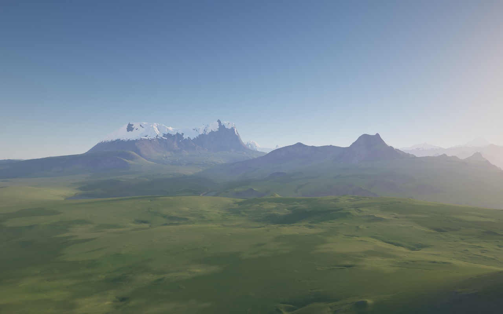

# Montagnes

Générateur de paysages infinis rendus en temps réel par raymarching sur le GPU. Il n'y a ni maillage ni phase de
génération : le relief est une fonction calculée pixel par pixel, avec un niveau de détail qui suit la taille d'un
pixel à l'écran.

**Démo : [redotheweb.com/mountains](http://www.redotheweb.com/mountains/)**



## Utilisation

```bash
npm install
npm run dev        # serveur de développement
npm test           # tests unitaires (origines des bruits, URL, constantes)
npm run typecheck
npm run build
```

Commandes : glisser pour regarder, ZQSD / WASD pour avancer, R / Espace et F pour monter et descendre, Maj pour
accélérer, molette pour la vitesse. La vue courante s'écrit dans l'URL (`#x=…&z=…&alt=…&yaw=…&pitch=…&seed=…`) et
dans le HUD : une capture d'écran suffit pour retrouver un point de vue.

Modes de développement : `#bench` mesure les performances et compare l'image à une référence, `#capture` rend les
vues de `captures/views.json`, `#probe-test` compare les sondes GPU à des altitudes de référence.

Chaque push sur `main` est testé, construit et publié sur la branche `gh-pages` (`.github/workflows/pages.yml`).

## Techniques

### Bruits procéduraux (`noise.glsl`)

1. **Hash entier sans texture** (« Integer Hash III » d'Inigo Quilez) : pseudo-aléatoire calculé à partir des
   coordonnées de cellule (`uvec2`).
2. **Value noise 2D à dérivées analytiques** (`noised`) : valeur et gradient exact, interpolation quintique.
3. **Bruit de gradient 2D mêlé au value noise** (`hybridNoised`) sur les grandes octaves de la haute montagne :
   gradients tirés des bits des mêmes hashs, sans table. Le value noise seul pose des dômes sur les sommets de sa
   grille ; le bruit de gradient seul passe par zéro à chaque sommet, et ses arêtes y feraient des cônes réguliers.
4. **Bruit de gradient 3D** type Perlin, gradients uniformes sur la sphère, pour la couleur de la roche.
5. **Perlin « amélioré » à 12 gradients d'arêtes** : variante moins coûteuse, pour creuser les parois.
6. **fBm** (fractional Brownian motion) : somme d'octaves, chacune tournée (matrice `M2`) et de fréquence doublée,
   pour casser l'alignement sur la grille.

### Modélisation du relief (`height.glsl`, `climate.glsl`, `rock.glsl`)

7. **fBm « à dérivées »** (érosion simulée) : la pente accumulée atténue les octaves suivantes
   (`1/(1+dot(d,d))`), d'où des vallées douces et des versants érodés.
8. **Ridged noise** (`1 - 2|n|`) sur les pentes raides pour des arêtes vives, avec un signe adouci pour éviter les
   marches dans le relief. En haute montagne, il façonne aussi les grandes formes : les grandes octaves, sauf la
   première, deviennent des crêtes arrondies là où le massif est haut, et les plus fines naissent près de celles de
   l'octave précédente (contreforts, cols, cirques) ; seule leur raideur, et non le sens de leur pente, compte dans
   l'érosion des octaves suivantes.
9. **Propagation de la jacobienne** à travers les octaves, pour la vraie pente en m/m.
10. **Biomes continus** : quatre champs de bruit à très grande échelle (continent, aridité, chaînes, îles)
    interpolent les paramètres du relief, sans frontière nette. La haute montagne repose sur un socle de 1500 m.
11. **Falaises côtières** construites comme une marche sur les grandes formes, avec une distance au pied de la
    falaise pour le raymarching.
12. **Dunes procédurales** : profil asymétrique (versant au vent doux, face d'avalanche raide), phase déformée par
    domain warping, croissants et barkhanes, raccords par smooth min/max (`softMin`, `softMaxDune`).
13. **Champ de hauteur + creusement 3D** : sur les parois verticales, un champ de hauteur ne ferait que s'étirer ;
    on soustrait un bruit 3D, et le terrain devient une fonction de distance hybride (`surfaceDistance`).
14. **Bornes de Lipschitz** : la distance est divisée par la pente maximale du bruit, pour que les rayons ne
    traversent pas la surface.

### Raymarching (`raymarch.glsl`)

15. **Raymarching d'un champ de hauteur / d'une SDF**, pas proportionnel à l'écart vertical (`uStep`).
16. **Sur-relaxation** (ω = 1,6) avec repli si deux sphères de sécurité ne se recouvrent plus (Keinert et al.).
17. **Affinage de l'impact par dichotomie** (6 itérations).
18. **Saut initial** jusqu'à l'altitude maximale du relief (`uMaxH`), et sortie anticipée quand le rayon remonte
    au-dessus.
19. **Courbure terrestre** simulée en courbant le rayon (terme en t²/2R) plutôt que la Terre, avec intersection
    analytique de la sphère d'eau.
20. **Ombres douces** à la Inigo Quilez (`min(k·h/t)`), avec un niveau de détail décroissant le long du rayon
    d'ombre.
21. **Normales par différences finies sur un tétraèdre** (4 évaluations au lieu de 6), à l'échelle d'un pixel.

### Niveau de détail et précision

22. **LOD au pixel près** (`lod(t)`) : seules les octaves plus larges que deux pixels à la distance t sont
    gardées, avec un fondu de la dernière : un filtrage analytique de l'aliasing.
23. **Effacement selon l'empreinte en profondeur** : vu en rasant, un pixel couvre 1/cos plus de sol, les détails
    s'effacent donc plus tôt.
24. **Origines en double précision** (`origins.ts`) : le CPU calcule en float64 la cellule entière et la partie
    fractionnaire de la caméra pour chaque octave, le GPU n'ajoute que la petite position relative
    (camera-relative rendering). Le monde reste précis à des milliers de kilomètres de l'origine.

### Matériaux et éclairage (`shading.glsl`)

25. **Normale fine et normale grossière** : la fine pour l'éclairage, la grossière pour la répartition des
    matériaux (neige, herbe, roche).
26. **Cavité** obtenue par différence entre deux LOD : creux et bosses pilotent l'occlusion, la neige et la
    végétation.
27. **Texturage procédural** : strates de roche inclinées, lichens, herbe, forêt en massifs aux lisières découpées,
    blocs d'éboulis (un bloc aléatoire par cellule, jittered grid), neige dépendant de l'exposition.
28. **Micro-relief en normal perturbation seulement** : rides de sable, touffes, sastrugi et éboulis inclinent la
    normale sans toucher à la géométrie.
29. **Éclairage ambiant** : irradiance du ciel échantillonnée selon quelques directions pondérées, plus la lumière
    renvoyée par le sol et les versants d'en face.
30. **Eau** : Fresnel, rayons réfléchis re-marchés avec un budget réduit, reflet du soleil en GGX élargi avec la
    distance, absorption selon la profondeur (le rouge disparaît en premier), écume sur les côtes marines.

### Atmosphère (`atmosphere.glsl`)

31. **Diffusion de Rayleigh + Mie** (aérosols) intégrée analytiquement pour une densité exponentielle, sans marcher
    dans l'atmosphère.
32. **Fonction de phase de Henyey-Greenstein** (g = 0,85) pour le halo solaire.
33. **Absorption par l'ozone** (bande de Chappuis), qui empêche le ciel de virer au vert au couchant.
34. **Masse d'air de Kasten-Young** pour la couleur du soleil selon sa hauteur.
35. **Diffusion multiple** approchée par un terme isotrope.
36. **Ciel et brume unifiés** : la même intégrale, prise jusqu'à l'infini pour le ciel, d'où un raccord sans
    jointure.
37. **Ombre volumétrique du relief dans l'air** (`shadowedLength`) : rayons crépusculaires bon marché.

### Post-traitement et pipeline (`terrain.frag.glsl`, `scheduler.ts`, `renderer.ts`)

38. **Exposition auto-adaptative** fondée sur la luminance d'un sol plat, avec compensation du contre-jour.
39. **Tone mapping ACES** (approximation de Narkowicz), puis gamma.
40. **Vignettage, éblouissement solaire, grain fixe** servant de dithering contre le banding.
41. **Résolution adaptative** : aperçu dont l'échelle suit la cadence mesurée (médiane et zone morte).
42. **Raffinement progressif** par niveaux de résolution, calculés par bandes sur plusieurs images.
43. **Antialiasing par accumulation** : 6 rendus décalés d'un sous-pixel (`uJitter`), moyennés par blending
    avec `CONSTANT_ALPHA`.
44. **Lecture GPU → CPU asynchrone (« sondes »)** : `readPixels` vers un PBO, `fenceSync` puis `getBufferSubData`,
    floats empaquetés bit à bit dans du RGBA8.
45. **Assemblage modulaire des shaders**, constantes TypeScript injectées en tête du GLSL.

## Le relief n'existe qu'en GLSL

Le CPU a pourtant besoin du relief : altitude du sol pour placer la caméra et l'empêcher de traverser le relief,
biome et hauteur au-dessus du sol pour le HUD et l'URL, soleil caché ou non par le relief pour l'éblouissement. Il
les demande au GPU par des sondes : un petit programme, assemblé des mêmes modules que le terrain avec un autre
`main()` (`render/probe.frag.glsl`), calcule ces valeurs pour un point et les relit sans bloquer, une à deux images
plus tard.

La caméra garde la dernière réponse, associée à la position et aux réglages sondés. Elle ne se place qu'une fois
la réponse reçue (chargement, URL, téléportation, #bench, #capture) : rien n'est dessiné avant. En vol, la
collision se sert de la réponse précédente ; la sonde relève aussi le sol le plus haut sur le trajet prévu
jusqu'à la réponse suivante, ce qui sert de marge. L'image nette attend la sonde de la position finale. Les
constantes n'existent qu'une fois, dans `terrain/constants.ts`. `#probe-test` vérifie que des altitudes de
référence ne changent pas.

## Organisation

```
src/
├── main.ts          Assemblage : canvas, caméra, panneau, boucle d'animation
├── params.ts        Réglages modifiables depuis le panneau
├── gui.ts           Panneau de réglages (lil-gui)
├── camera.ts        Caméra de vol libre, sondes du sol et du soleil, vue transmise au shader
├── scheduler.ts     Ordonnancement des images : aperçu adaptatif, image nette par bandes, export
├── hud.ts           Texte du HUD
├── viewUrl.ts       Vue ↔ URL, point de départ par défaut
├── bench.ts, capture.ts, probeTest.ts   Modes #bench, #capture et #probe-test
├── terrain/         Données du relief côté CPU (le relief lui-même n'existe qu'en GLSL)
│   ├── constants.ts Constantes du relief (source unique, injectées dans le GLSL)
│   ├── biomes.ts    Table des biomes et réglages dérivés, transmis au shader
│   └── origins.ts   Origines des bruits en double précision (précision à grande distance)
└── render/          Rendu WebGL2
    ├── renderer.ts  Programmes, cibles, envoi des uniformes, sondes ; assemble les shaders
    ├── uniforms.glsl, noise.glsl, climate.glsl, rock.glsl, height.glsl   Relief
    ├── raymarch.glsl, atmosphere.glsl, shading.glsl
    ├── terrain.frag.glsl  main() du shader de terrain
    ├── probe.frag.glsl    main() des sondes
    └── fullscreen.vert.glsl, blit.frag.glsl
```

## Licence

[MIT](LICENSE)
